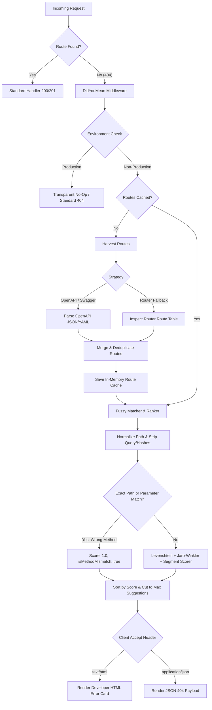

# go-didyoumean

[](https://pkg.go.dev/github.com/eslam-amin/go-didyoumean)
[](https://goreportcard.com/report/github.com/eslam-amin/go-didyoumean)
[](https://opensource.org/licenses/MIT)

> Intelligent, zero-config 404 route suggester for Go REST APIs (**Gin**, **Chi**, **Echo**, and **`net/http`**). Catches unhandled routes, computes fuzzy string and structural similarities, highlights HTTP method mismatches, and suggests the closest endpoints via JSON or a sleek developer HTML error card.

---

## Highlights & Key Features

- **OpenAPI & Router Discovery:** Seamlessly parses OpenAPI 2.0 (Swagger) and 3.0/3.1 specs (JSON/YAML, local files, byte slices, or remote URLs) and merges them with router-harvested route tables.
- **Zero-Overhead Production Guardrail:** Instantly bypasses in production (`ENV=production`, `GIN_MODE=release`, etc.) with **0 route walking, 0 allocations, and 0 regex evaluation**.
- **Multi-Metric Fuzzy Matching:** Combines **Positional Segment Similarity**, **Jaro-Winkler**, and **Levenshtein Distance** with Unicode rune awareness.
- **Method Mismatch Prioritization (Critical Feature):** Detects if the path matches structurally (e.g. `POST /api/v1/users`) while only another method is registered (`GET /api/v1/users`). Assigns score `1.0`, flags `isMethodMismatch: true`, and sorts it to the top.
- **Developer Error UI Card:** Automatic content negotiation renders a dark-mode developer HTML card with method color badges when requested from a browser (`Accept: text/html`), or structured JSON for API clients.
- **Multi-Router Support:** First-class support for **Gin**, **Chi**, **Echo**, and standard **`net/http`** (Go 1.22+).
- **Thread-Safe Single-Pass Caching:** Uses `sync.Once` and `sync.RWMutex` to ensure route discovery runs exactly once.

---

## Architecture



---

## Installation

```bash
go get github.com/eslam-amin/go-didyoumean
```

---

## Quick Start

### 1. Gin

```go
package main

import (
	"net/http"

	"github.com/eslam-amin/go-didyoumean"
	"github.com/gin-gonic/gin"
)

func main() {
	r := gin.Default()

	// Register didyoumean middleware
	r.Use(didyoumean.GinMiddleware(r, didyoumean.Options{
		OpenAPISpec:    "./openapi.yaml", // optional: path, URL, or []byte
		MaxSuggestions: 3,
		Threshold:      0.4,
	}))

	r.GET("/api/v1/users", func(c *gin.Context) {
		c.JSON(http.StatusOK, gin.H{"users": []string{"alice", "bob"}})
	})
	r.POST("/api/v1/users", func(c *gin.Context) {
		c.Status(http.StatusCreated)
	})

	r.Run(":8080")
}
```

*Or use with `r.NoRoute(didyoumean.GinNoRouteHandler(r, opts))`.*

---

### 2. Chi

```go
package main

import (
	"net/http"

	"github.com/eslam-amin/go-didyoumean"
	"github.com/go-chi/chi/v5"
)

func main() {
	r := chi.NewRouter()

	opts := didyoumean.Options{
		OpenAPISpec: "./openapi.json",
	}

	// Register custom 404 handler
	r.NotFound(didyoumean.ChiNotFoundHandler(r, opts))

	r.Get("/api/v1/articles", func(w http.ResponseWriter, r *http.Request) {
		w.Write([]byte("articles list"))
	})

	http.ListenAndServe(":8080", r)
}
```

---

### 3. Echo

```go
package main

import (
	"net/http"

	"github.com/eslam-amin/go-didyoumean"
	"github.com/labstack/echo/v4"
)

func main() {
	e := echo.New()

	opts := didyoumean.Options{
		MaxSuggestions: 3,
	}

	// Catch unmapped routes
	e.RouteNotFound("/*", didyoumean.EchoNotFoundHandler(e, opts))

	e.GET("/api/v1/orders", func(c echo.Context) error {
		return c.String(http.StatusOK, "orders")
	})

	e.Start(":8080")
}
```

---

### 4. Standard `net/http` (Go 1.22+)

```go
package main

import (
	"net/http"

	"github.com/eslam-amin/go-didyoumean"
)

func main() {
	mux := http.NewServeMux()

	routes := []didyoumean.RouteEntry{
		{Path: "/api/v1/products", Methods: []didyoumean.HttpMethod{didyoumean.MethodGet}},
		{Path: "/api/v1/products", Methods: []didyoumean.HttpMethod{didyoumean.MethodPost}},
	}

	opts := didyoumean.Options{MaxSuggestions: 3}
	notFoundHandler := didyoumean.HTTPNotFoundHandler(routes, opts)

	mux.HandleFunc("GET /api/v1/products", func(w http.ResponseWriter, r *http.Request) {
		w.Write([]byte("products"))
	})

	// Fallback handler for unmatched paths
	mux.HandleFunc("/", notFoundHandler)

	http.ListenAndServe(":8080", mux)
}
```

---

## Response Formats

### 1. Default JSON (`Accept: application/json`)

When an endpoint is not found (e.g. client makes a typo `GET /api/v1/usr`):

```json
{
  "statusCode": 404,
  "error": "Not Found",
  "message": "Cannot GET /api/v1/usr",
  "suggestions": [
    {
      "method": "GET",
      "path": "/api/v1/users",
      "score": 0.8841,
      "isMethodMismatch": false,
      "summary": "List all active users"
    }
  ]
}
```

### 2. Method Mismatch (`POST /api/v1/users` when only `GET` is registered)

```json
{
  "statusCode": 404,
  "error": "Not Found",
  "message": "Cannot POST /api/v1/users",
  "suggestions": [
    {
      "method": "GET",
      "path": "/api/v1/users",
      "score": 1.0,
      "isMethodMismatch": true,
      "summary": "List all active users"
    }
  ]
}
```

### 3. Developer HTML Error Card (`Accept: text/html`)

If the request comes from a browser or API tool asking for HTML, `didyoumean` returns a dark-mode developer card detailing:
- 404 Not Found status header
- Requested method and path
- Colored method badges (`GET` in green, `POST` in amber, `PUT` in blue, `DELETE` in red)
- Percentage similarity indicator pills
- `Method Mismatch` warning badge if the path exists for other methods
- OpenAPI route summary and description

---

## Configuration Options

| Option | Type | Default | Description |
|---|---|---|---|
| `OpenAPISpec` | `any` | `nil` | File path (`string`), remote URL (`http(s)://`), raw `[]byte`, or `io.Reader` for Swagger 2.0 or OpenAPI 3.x specs. |
| `MaxSuggestions` | `int` | `3` | Maximum number of route suggestions to return. |
| `Threshold` | `float64` | `0.4` | Minimum similarity score (0.0 to 1.0) required to include a candidate route. |
| `Enabled` | `*bool` | `nil` | Explicit toggle to enable or disable the middleware regardless of environment. |
| `EnabledEnvironments` | `[]string` | `nil` | Slice of allowed environments (e.g. `[]string{"development", "staging"}`). If empty, automatically active everywhere except production. |
| `ExcludeRoutes` | `[]string` | `nil` | List of exact routes or wildcard patterns to hide from suggestions (e.g. `[]string{"/health", "/metrics/*"}`). |
| `IncludeMethodMismatches` | `*bool` | `true` | When true, prioritizes structural path matches having wrong HTTP methods with score `1.0`. |
| `FormatResponse` | `func` | `nil` | Custom JSON response callback: `func(suggestions []RouteSuggestion, r *http.Request) any`. |
| `CustomHTMLRenderer` | `func` | `nil` | Custom HTML renderer callback: `func(w http.ResponseWriter, r *http.Request, suggestions []RouteSuggestion) error`. |

---

## Fuzzy Scoring Algorithm

The hybrid scoring engine combines three metrics:

$$\text{Score} = 0.5 \times \text{SegmentSim} + 0.3 \times \text{JaroWinkler} + 0.2 \times \text{Levenshtein}$$

1. **Segment Similarity:** Evaluates path segments positionally and dynamically handles route parameters (`:id`, `{id}`, `*catchall`).
2. **Jaro-Winkler Similarity:** Boosts common prefixes (critical for `/api/v1/...` REST hierarchies).
3. **Levenshtein Distance:** Normalizes edit operations (insertions, deletions, substitutions) over Unicode runes.
4. **Structural Matcher:** Paths matching static segments and dynamic parameters receive maximum priority (`score: 0.99 - 1.0`).

---

## Publishing to Go Modules (`pkg.go.dev`)

Go packages are distributed via Git tags:

```bash
# 1. Commit changes
git add .
git commit -m "feat: initial release of didyoumean route suggester"

# 2. Tag a SemVer release
git tag v1.0.0

# 3. Push to GitHub
git push origin main
git push origin v1.0.0

# 4. Trigger Go Proxy indexing
GOPROXY=https://proxy.golang.org go list -m github.com/eslam-amin/go-didyoumean@v1.0.0
```

Within minutes, your package documentation will be available at:
**`https://pkg.go.dev/github.com/eslam-amin/go-didyoumean`**

---

## License

MIT License. See [LICENSE](LICENSE) for details.
